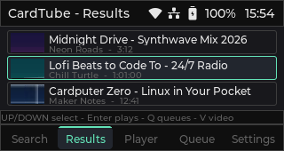
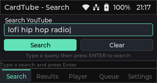
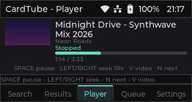
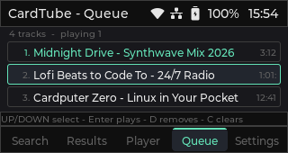
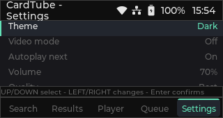

<p align="center">
  <picture>
    <source media="(prefers-color-scheme: dark)" srcset="./screenshot/cardtube_02_results.png" />
    <source media="(prefers-color-scheme: light)" srcset="./screenshot/cardtube_02_results.png" />
    
  </picture>
</p>

<div align="center">
  <h1>CardTube</h1>
</div>

<div align="center">
  <p>Client YouTube audio e video, nativo in C++/LVGL, per M5Stack Cardputer Zero.</p>
</div>

<p align="center">
  
  
  
  
</p>

## Cos'è CardTube

CardTube trasforma il Cardputer Zero in un piccolo lettore YouTube tascabile.
Non è un telecomando e non è un client audio-only: cerca i video tramite
`yt-dlp`, li riproduce con `mpv` e, quando vuoi, passa al video a schermo
intero sul display da 320x170.

L'interfaccia è scritta in C++17 con LVGL 9.5 e gira direttamente sul
framebuffer (`/dev/fb0`) del dispositivo, senza desktop environment. Il
pacchetto `.deb` installa il binario, gli asset, il file di configurazione e la
voce APPLaunch, così l'app compare nel launcher e nello store.

## Funzioni

- **Ricerca YouTube** con `yt-dlp` (`--flat-playlist`), risultati con titolo,
  canale, durata e miniatura.
- **Riproduzione audio** con un demone `mpv` persistente in modalità
  `--no-video`: la UI resta visibile e reattiva mentre la musica suona.
- **Riproduzione video** a schermo intero: CardTube cede il framebuffer a un
  processo `mpv` one-shot (`--vo=fbdev`, fallback `--vo=gpu --gpu-context=drm`)
  e riprende la UI alla chiusura.
- **Coda di riproduzione** con aggiunta, rimozione, svuotamento e avanzamento
  automatico a fine traccia.
- **Miniature** scaricate in cache (`<runtime>/thumbs/<id>.jpg`) e mostrate
  nelle liste e nella schermata di riproduzione.
- **Cinque pagine**: Search, Results, NowPlaying, Queue, Settings.
- **Interfaccia in italiano o inglese** (`language=en/it`) selezionabile dalle
  Settings.
- **Tastiera integrata CardputerZero** decodificata con la mappa ufficiale
  M5Stack: i simboli del layer **Sym** (`!@#$%^&*()[]{}` …) e i tasti
  multimediali **Fn** (play/pausa, precedente, successivo, mute, volume)
  funzionano in ogni pagina. La mappa non altera eventuali tastiere USB esterne.
- **Uscita audio selezionabile**: cassa interna oppure cuffie/speaker Bluetooth
  già accoppiati, con connessione dalle Settings e passaggio immediato dello
  stream `mpv` (PipeWire/PulseAudio, incluso il target esplicito `audio-device`).
- **Tema chiaro/scuro**, volume, qualità e autoplay configurabili e persistiti.
- **Controllo dipendenze** integrato (presenza di `yt-dlp`, `mpv`, `curl` e
  aggiornamento di `yt-dlp` dalla pagina Settings).
- **Screenshot PNG** catturabili dalla UI (tasto PrintScreen).

## Screenshot

| Search | Results | Player |
| --- | --- | --- |
|  |  |  |

| Queue | Settings |
| --- | --- |
|  |  |

## Requisiti

Sul dispositivo:

- M5Stack Cardputer Zero (Raspberry Pi CM0, aarch64, Debian).
- `mpv`, `yt-dlp`, `curl`, `python3` (dichiarati come dipendenze del `.deb`).
- Connessione Wi-Fi 2.4 GHz attiva.

Per la compilazione:

- CMake >= 3.31, Ninja, un compilatore C++17.
- Build desktop: SDL2, FreeType, libpng, libjpeg-turbo, fmt.
- Build cross aarch64: `crossbuild-essential-arm64` (o toolchain
  `aarch64-linux-gnu-gcc/g++` equivalente). Il sysroot BSP viene scaricato
  automaticamente al primo configure.

## Installazione sul dispositivo

Copiare il pacchetto e installarlo con `apt`:

```shell
scp dist/CardTube_0.4.2_rev1_arm64.deb <utente>@<ip-dispositivo>:~/
ssh <utente>@<ip-dispositivo>
sudo apt install --no-install-recommends ./CardTube_0.4.2_rev1_arm64.deb
```

Il pacchetto installa:

| Percorso | Contenuto |
| --- | --- |
| `/usr/bin/cardtube` | Eseguibile dell'app. |
| `/etc/cardtube.conf` | Configurazione di sistema (conffile). |
| `/usr/share/cardtube/` | Asset runtime (font, immagini, audio). |
| `/usr/share/APPLaunch/applications/cardtube.desktop` | Voce APPLaunch. |
| `/usr/share/APPLaunch/share/images/cardtube*.png` | Icona del launcher. |
| `/usr/share/doc/cardtube/` | README e licenze di terze parti. |

Il pacchetto non installa servizi systemd: le app vengono lanciate da APPLaunch.
Per un avvio automatico in installazioni embedded riconfigura con
`-DAPP_INSTALL_SYSTEMD_SERVICE=ON` e imposta un `User=` non-root nell'unità
(lo store rifiuta i servizi che girano come root).

## Comandi da tastiera

`Tab` e `Shift+Tab` cambiano pagina da qualsiasi schermata. `ESC` torna
indietro; sulla pagina Search una pressione breve "arma" l'uscita (un secondo
`ESC` o una pressione lunga chiude l'app). Durante la riproduzione video `ESC`
chiude il player.

### Tastiera integrata

Il Cardputer Zero ha 46 tasti senza punteggiatura dedicata. CardTube decodifica
la tastiera `tca8418` con la mappa ufficiale M5Stack:

- **Lettere** seguono la serigrafia fisica (`qwertyuiop`, `asdfghjkl`,
  `zxcvbnm`), con **Shift** per le maiuscole.
- **Shift** produce anche i simboli della fila numerica (`!@#$%^&*()`).
- **Sym** attiva i simboli blu stampati sui tasti: `` ` ~ ! @ # $ % ^ & * ( ) - _ = + [ ] { } ; : ' " , . / \ | < > ? ``.
- **Fn** attiva i tasti arancioni. CardTube gestisce `Fn+Q/W/E` (play-pausa,
  precedente, successivo), `Fn+A/S/D` (mute, volume giù, volume su) e le frecce
  `Fn+F/X/Z/C`, oltre a `Fn+H` (aiuto), `Fn+J` (screenshot) e `Fn+Backspace`
  (Canc).

### Search

| Tasto | Azione |
| --- | --- |
| `A-Z`, `0-9`, simboli | Digita la query. |
| `ENTER` | Avvia la ricerca. |
| `BACKSPACE` | Cancella un carattere. |
| `Tab` / `Shift+Tab` | Pagina successiva / precedente. |
| `PrintScreen` | Salva uno screenshot PNG. |

### Results

| Tasto | Azione |
| --- | --- |
| `Su` / `Giù` | Sposta la selezione. |
| `ENTER` o `Spazio` | Riproduce l'elemento selezionato (audio) e lo accoda. |
| `Q` | Aggiunge alla coda senza interrompere la riproduzione. |
| `V` | Apre il video a schermo intero. |
| `ESC` o `/` | Torna alla ricerca. |

### NowPlaying

| Tasto | Azione |
| --- | --- |
| `Spazio` | Pausa / riprendi. |
| `Sinistra` / `Destra` | Sposta di 10 secondi. |
| `-` / `+` | Volume giù / su. |
| `N` / `P` | Traccia successiva / precedente. |
| `V` | Guarda la traccia corrente in video. |
| `S` | Ferma la riproduzione. |
| `ESC` | Torna ai risultati. |

### Queue

| Tasto | Azione |
| --- | --- |
| `Su` / `Giù` | Sposta la selezione. |
| `ENTER` o `Spazio` | Riproduce la voce selezionata. |
| `D` o `Canc` | Rimuove la voce selezionata. |
| `C` | Svuota la coda. |
| `ESC` | Torna al player. |

### Settings

| Tasto | Azione |
| --- | --- |
| `Su` / `Giù` | Sposta la selezione. |
| `Sinistra` / `Destra` | Modifica il valore. |
| `ENTER` o `Spazio` | Attiva la riga. |
| `R` | Ricontrolla le dipendenze. |
| `U` | Aggiorna `yt-dlp`. |
| `I` | Mostra le versioni. |
| `ESC` | Torna alla ricerca. |

Le righe **Language** e **Audio output** cambiano al volo rispettivamente
l'interfaccia e l'uscita audio. La lingua è salvata in `language` nel file di
configurazione.

La riga **Audio output** elenca la cassa interna e le cuffie Bluetooth già
accoppiate: con `Sinistra`/`Destra` si sceglie l'uscita, `Invio` la attiva (o
connette il dispositivo Bluetooth selezionato) e aggiorna l'elenco. La scelta è
salvata in `audio_output`; vuoto significa uscita di sistema predefinita.

## Log e diagnostica

Quando CardTube è avviata da APPLaunch lo stdout non è visibile, quindi l'app
scrive due file leggibili via SSH:

| File | Contenuto |
| --- | --- |
| `/tmp/cardtube/cardtube.log` | Sink audio trovati, esito di `pactl`/`bluetoothctl`, proprietà audio di `mpv`, self-test della tastiera. |
| `/tmp/cardtube/mpv.log` | Log completo di `mpv` (`--log-file`). |

```shell
ls -l /tmp/cardtube/
tail -n 100 /tmp/cardtube/cardtube.log
tail -n 100 /tmp/cardtube/mpv.log
```

## Configurazione

Configurazione di sistema: `/etc/cardtube.conf`.

```ini
# CardTube configuration
# dark_mode: yes/no, video_mode: open mpv fullscreen instead of audio only
# language: en/it
# audio_output: PipeWire/PulseAudio sink name; empty = system default
[application]
dark_mode=yes
video_mode=no
autoplay_next=yes
volume=80
quality=best
language=en
audio_output=
```

Le modifiche fatte dalla pagina Settings vengono salvate nel file utente:

- `$XDG_CONFIG_HOME/cardtube/cardtube.conf` se `XDG_CONFIG_HOME` è impostata;
- altrimenti `$HOME/.config/cardtube/cardtube.conf`;
- fallback `/tmp/cardtube/cardtube.conf` se la home non è scrivibile.

Il file utente ha precedenza su `/etc/cardtube.conf` al lancio successivo.

## Compilazione

### Desktop (anteprima UI)

```shell
cmake --preset linux-x86-64
cmake --build --preset linux-x86-64-rel
./build/linux-x86-64/Release/cardtube
```

Su Windows con MSYS2/MinGW64 il progetto è stato validato con:

```powershell
cmake -G Ninja -B build/mingw-desktop -DUSE_DESKTOP=ON -DCMAKE_BUILD_TYPE=Release
cmake --build build/mingw-desktop
```

### Screenshot per lo store

La modalità demo riempie la UI con contenuti di esempio, cicla le cinque
pagine e salva i PNG a 320x170:

```powershell
powershell -File tools\make_demo_thumbs.ps1
$env:CARDTUBE_DEMO = "1"
$env:CARDTUBE_SCREENSHOT_DIR = "C:\percorso\screenshot"
.\build\mingw-desktop\cardtube.exe
```

Su Linux la stessa variabile `CARDTUBE_SCREENSHOT_DIR` accetta un percorso
assoluto. `tools/make_icon.ps1` rigenera l'icona 256x256
`assets/images/cardtube.png`.

### Cross build aarch64 e pacchetto `.deb`

Su un host Debian/Ubuntu:

```shell
sudo apt install crossbuild-essential-arm64 ninja-build dpkg-dev
cmake --workflow --preset cp0-cross-package
```

Il flusso configura `cp0-cross`, compila in Release e genera il pacchetto in
`dist/`. In alternativa, passo per passo:

```shell
cmake --preset cp0-cross
cmake --build --preset cp0-cross-rel
cpack --preset cp0-cross-deb
```

Il workflow GitHub Actions in `.github/workflows/build-deb.yml` esegue lo
stesso flusso su `ubuntu-24.04`, valida i metadati, allega il `.deb` come
artifact e (sui tag `v*`) lo pubblica in una release GitHub. Un secondo job
compila la variante desktop su Linux come test di regressione.

### Deploy rapido

```shell
REMOTE_USER=<utente> REMOTE_HOST=<ip> ./deploy.sh
```

Lo script compila, crea il pacchetto e lo copia nella home del dispositivo.

## Struttura del progetto

```text
.
├── assets/                  # Font, immagini e audio runtime
├── cmake/                   # Toolchain, template desktop/service e packaging Debian
├── config/cardtube.conf     # Configurazione di sistema installata in /etc
├── screenshot/              # Screenshot 320x170 per README e store
├── src/
│   ├── app/                 # Ciclo di vita, gestione schermate, asset, simulatore desktop
│   ├── config/              # lv_conf.h (desktop e CM0)
│   ├── logger/              # Wrapper di logging basato su fmt
│   ├── model/               # Stato dell'app (pagine, coda, impostazioni, config)
│   ├── platform/            # Processi, yt-dlp, mpv (IPC e video), input evdev, screenshot
│   ├── reactive/            # Subject LVGL e binding
│   ├── view/                # Tema, schermate e widget
│   ├── viewmodel/           # Logica applicativa e soggetti osservabili
│   └── main.cpp             # Entry point
├── tools/                   # Script per icona, miniature demo, identità e preflight
├── CMakeLists.txt
├── CMakePresets.json
├── PUBLISHING.md            # Passi per pubblicare repo, .deb e store
└── app-builder.json         # Metadati per lo store CardputerZero
```

## Note tecniche

- **Audio**: un solo processo `mpv --no-video --idle` resta attivo e viene
  pilotato via socket Unix (`platform/mpv_ipc`). La UI continua a girare a
  60 fps e mostra posizione e durata.
- **Video**: `platform/mpv_video` avvia un `mpv` separato sul framebuffer e
  mette in pausa il refresh LVGL; al termine la UI viene ridisegnata.
- **Ricerche e download** girano su thread di lavoro e tornano sul thread LVGL
  tramite `platform::post_to_ui`, senza mai toccare LVGL da altri thread.
- **Miniature**: `curl` scarica `mqdefault.jpg` (fallback `default.jpg`) in
  `<runtime>/thumbs/`, caricate da LVGL con il filesystem `A:` e ricaricate
  forzando il drop della cache immagine.
- **Font**: su dispositivo vengono usati i Noto Sans CJK di sistema via
  FreeType; se mancano si ricade su Montserrat (taglie 10/12/14/16/18/20/24).

## Pubblicazione

La release è già predisposta:

```powershell
python tools/set_identity.py --name "<nome>" --email "<email>" `
  --github "<login>" --display-name "<nome>" --share-code "<AB12>"
python tools/preflight.py
```

`tools/preflight.py` verifica manifest, screenshot 320x170, icona quadrata,
`share_code`, permessi e maintainer: se passa, il pacchetto è pronto per
GitHub Actions e per lo store. La procedura completa (repo GitHub, artifact,
tag di release, upload sullo store) è in [`PUBLISHING.md`](PUBLISHING.md); la
cronologia delle versioni è in [`CHANGELOG.md`](CHANGELOG.md).

## Licenza

Rilasciato sotto licenza MIT. I dettagli delle risorse di terze parti sono in
`assets/fonts/LICENSE.txt`.
